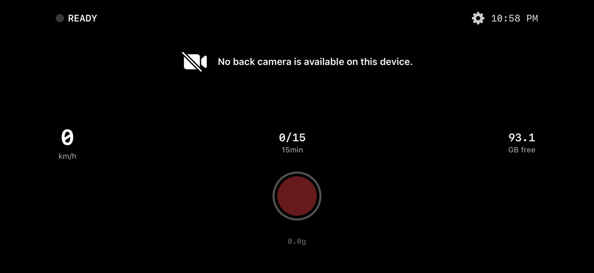
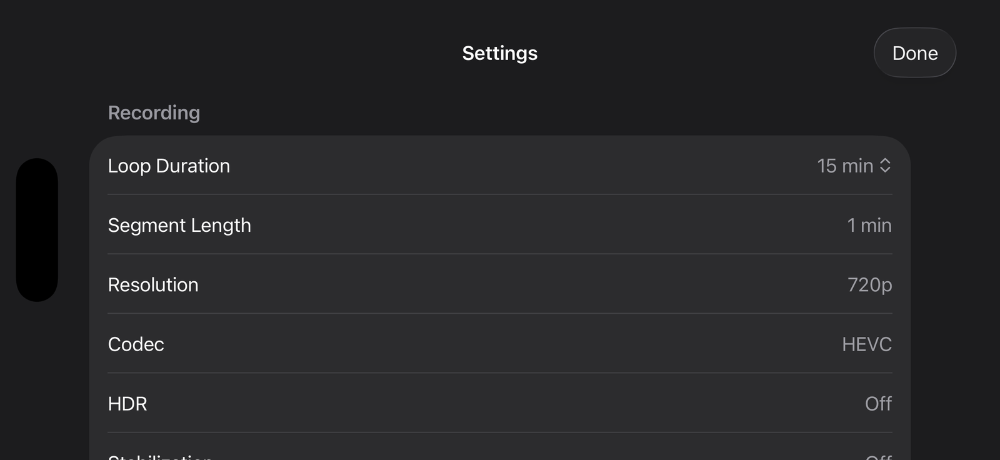
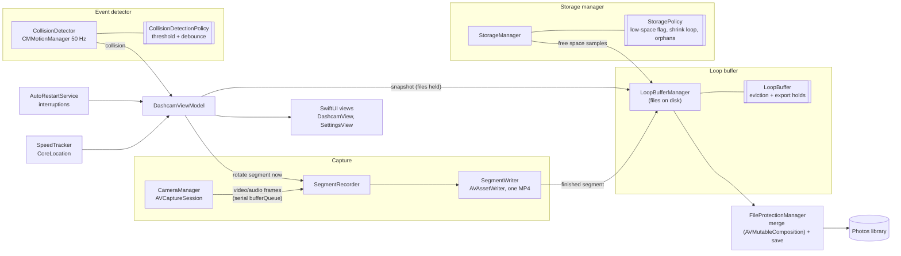

# DashCam for iOS

[](https://github.com/Ctwqk/ios-dashcam/actions/workflows/ci.yml)

A SwiftUI dashcam for iPhone: it records in a continuous loop, keeps only the last N minutes on disk, and when the
accelerometer detects an impact it saves the footage leading up to it to the Photos library.

<p align="center">
  
  
</p>

*Real captures of the app running in the iOS Simulator, taken by the CI job (`scripts/capture-screenshots.sh`). The
simulator has no camera, so the live preview is replaced by the app's "camera unavailable" empty state. See
[What has and has not been verified](#what-has-and-has-not-been-verified).*

## Features

- **Loop recording**: 60-second MP4 segments (720p, 30 fps, HEVC, `AVAssetWriter`). Only the newest 15 to 360 minutes
  (configurable) are kept; older segments are deleted as new ones arrive. Rotation hands the next incoming video frame to
  a fresh writer. Encoder backpressure or capture overload can still drop frames; gap-free capture has not been verified.
- **Collision detection**: the accelerometer is sampled at 50 Hz. A sample whose magnitude reaches the threshold
  (1.5 to 6.0 g, default 3.0 g, adjustable in Settings) raises one event; further samples are ignored for 10 seconds.
  On a collision the current segment is closed half a second later and the **whole buffer** is merged into one clip and
  saved to Photos while recording continues.
- **Manual save**: tapping stop offers *Save to Photos* (merge a snapshot, then remove only the saved segments),
  *Discard*, or *Continue Recording*. Footage recorded during an export stays in the loop.
- **HUD**: recording state and elapsed time, GPS speed (CoreLocation), segments in the buffer, free disk space,
  live g-force, collision and low-storage banners.
- **Storage management**: a low-storage warning below 1 GiB; when free space drops below 512 MiB the loop is shortened
  (oldest footage first, never below 2 segments) and restored when space frees up; segment files left behind by a
  crashed session are removed at launch.
- **Power and heat**: HDR and video stabilization are off, the screen dims while recording, and the frame rate is halved
  (minimum 15 fps) under serious thermal pressure.
- **Interruptions**: moving to the background, a phone call, another app taking the microphone, etc. pause recording
  (the current segment is finalized); it resumes automatically when the app is active again.
- **Metadata**: saved clips get the start time of the footage as their creation date and, when GPS has a fix, its location.
- English and Simplified Chinese strings.

## Tech stack

Swift 5 language mode, SwiftUI, Combine, AVFoundation (`AVCaptureSession`, `AVAssetWriter`, `AVMutableComposition`,
`AVAssetExportSession`), CoreMotion, CoreLocation, Photos, `os.Logger`; a local Swift package (`DashCamCore`) with XCTest;
GitHub Actions on macOS runners; SwiftLint.

## Architecture



The double-bracket boxes are the pure, unit-tested types in the `DashCamCore` package; everything else is the app
layer that owns sensors, threads and files.

**Threading model.** Frames arrive on one serial queue (`bufferQueue`). The active `AVAssetWriter`, the "accepting
frames" flag and the sample-buffer callbacks are confined to that queue; stop and rotate requests are dispatched onto it,
and `SegmentWriter` guards its state with a lock so a buffer can never be appended after its input was marked finished.
Writer results are delivered in recording order, and stop waits for every pending finalization before saving or
discarding. Session configuration and thermal changes run on a separate session queue; UI state lives on the main actor.

**Exports hold their files.** Merging a 6-hour buffer can take longer than a segment lasts. `LoopBuffer` therefore
supports reference-counted *holds*: a segment evicted from the loop while an export is reading it leaves the buffer
immediately, but its file is only deleted once the last export has released it.

## Permissions

| Permission | Why | If denied |
| --- | --- | --- |
| Camera (required) | record video | empty-state card with an *Open Settings* button |
| Microphone | record audio | footage is recorded without sound |
| Location, when in use | speed readout; location attached to saved clips | HUD shows "GPS off" |
| Photos, add only | save merged clips | the save fails with a message; the buffer is kept |
| Motion | collision detection (usage string is declared; raw accelerometer data needs no prompt) | none needed |

The app declares the `location` and `processing` background modes. iOS does not allow camera capture in the
background, so recording pauses when the app is backgrounded.

## Build and run

Requirements: macOS with Xcode 16 or newer (the export API requires the iOS 18 SDK; CI uses Xcode 26.6).
The app still supports iOS 17 through an older export API at runtime.

```bash
# Build for the iOS Simulator without code signing (this is what CI does)
make build
# or: xcodebuild build -project dashcam/DashCam.xcodeproj -scheme DashCam \
#       -destination 'generic/platform=iOS Simulator' CODE_SIGNING_ALLOWED=NO
```

To run on a **device**, open `dashcam/DashCam.xcodeproj` in Xcode and choose your own signing team (the project still
contains the original author's team ID). The camera, motion sensors and GPS only exist on a real iPhone.

## Tests

The decision logic lives in the `dashcam/DashCamCore` Swift package (Foundation only, 79 XCTest cases).
Another 10 simulator tests exercise the production media and interruption adapters with generated samples and notifications.

```bash
make test-core        # swift test on the macOS host (also works on Linux: cd dashcam/DashCamCore && swift test)
make test-core-ios    # the same tests inside an iOS Simulator
make test-app-ios     # synthetic video writing/merging and interruption recovery in an iOS Simulator
make lint             # SwiftLint (config in .swiftlint.yml)
make screenshots      # build, launch in a simulator, write build/screenshots/*.png
```

What the tests cover: loop-buffer eviction order and limits, export holds (including overlapping exports); collision
threshold, de-duplication of one impact sampled at 50 Hz, and the debounce window; storage quota maths (how many segments
to drop for a given shortfall) and orphan-file selection; file-name format, round-trip parsing and rejection of foreign
files; configuration persistence and range validation; encoder bit-rate based size estimates; thermal frame-rate
throttling; clip metadata; out-of-order writer completion, stop barriers, and snapshot-only cleanup after a save.
The simulator adapter tests verify playable H.264 output, a two-segment passthrough merge, rejection of corrupt input,
snapshot cleanup on disk, overlapping interruptions, cancelled restarts, observer registration, and runtime-error pausing.

## Project layout

```
dashcam/
  DashCam.xcodeproj
  DashCam/Sources/
    Camera/        CameraManager (session, permissions, thermal, runtime errors)
    Recording/     SegmentRecorder, SegmentWriter, LoopBufferManager, SampleBufferProcessor
    Detection/     CollisionDetector (sensor + threading around CollisionDetectionPolicy)
    Storage/       StorageManager, FileProtectionManager (merge + save to Photos)
    Services/      DashcamViewModel, AutoRestartService, SpeedTracker
    Views/         DashcamView, SettingsView, CameraPreviewView
    Support/       Logging
  DashCamCore/     Swift package: pure logic + tests (Sources/, Tests/)
  DashCamIOTests/  Tests compiling production adapters, without a camera or Photos permission
scripts/           simulator selection and screenshot capture
docs/              screenshots captured by CI
.github/workflows/ci.yml   SwiftLint, core + adapter tests, app build, screenshots
```

## Design notes and trade-offs

- **Pure core, thin shell.** Anything that can be decided without a camera, UIKit or the file system (what to evict, when
  an impact counts, how much space the loop may use, what a file is called) is a value type in `DashCamCore`; the app
  layer only owns I/O and threads. That is what makes the logic testable in CI, which has no camera.
- **Whole-buffer export on collision.** On impact the entire loop (up to the configured length) is saved, not a window
  around the impact. It is simple and never cuts off the lead-up; the cost is long clips and a long merge for big loops.
- **Passthrough merge.** Segments are concatenated with `AVAssetExportPresetPassthrough` (no re-encode): fast and
  lossless, but it needs free space roughly equal to the clip.
- **Explicit bit rates.** The encoder is asked for fixed average bit rates (720p HEVC 2.5 Mbps, 1080p HEVC 5 Mbps,
  H.264 4 and 8 Mbps), and the size estimate in Settings is computed from the same numbers.
- **Sensor timestamps for debouncing.** The collision policy uses the sensor's monotonic timestamps instead of `Date()`,
  which keeps it deterministic and unit-testable.
- **Keep footage if the save fails.** Unreadable segments fail the export instead of silently producing a partial clip.
  Only the saved snapshot is removed after Photos accepts the clip.

## Known limitations and roadmap

- Resolution, codec and segment length are fixed in code (Settings shows them read-only); only loop length and collision
  sensitivity can be changed.
- No crash recovery: segments from a previous session are deleted at launch rather than adopted.
- No in-app clip browser; clips live in Photos. `Segment.isProtected` is a leftover and unused.
- Video is always written with rotation angle 0 (landscape right). Mounting the phone the other way up is not handled
  and may give upside-down footage (untested).
- The camera session keeps running after recording stops (the preview stays live).
- The interruption banner texts ("App in background", ...) are not localized yet.
- No LICENSE file has been chosen yet.

## What has and has not been verified

Verified in CI on a `macos-latest` runner (Xcode 26.6, iOS 26.5 SDK):

- the app builds for the iOS Simulator with code signing disabled;
- all 79 `DashCamCore` tests pass, both with `swift test` on the macOS host and with `xcodebuild test` in an iOS
  Simulator (they also pass with Swift 6.0 on Linux);
- 10 simulator adapter tests pass, including generated video writing and merging;
- SwiftLint reports no violations;
- the app installs and launches in the simulator and renders the HUD and the Settings sheet (screenshots above).

**Not verified on hardware.** Neither CI nor this review had an iPhone. Live camera/audio capture, HEVC encoding,
saving to Photos, accelerometer-based detection, GPS, thermal throttling and real background behavior have not been
exercised end to end. Synthetic H.264 video tests and simulated interruption notifications do not establish hardware
reliability. The older iOS 17 export fallback also needs a device/runtime check.
